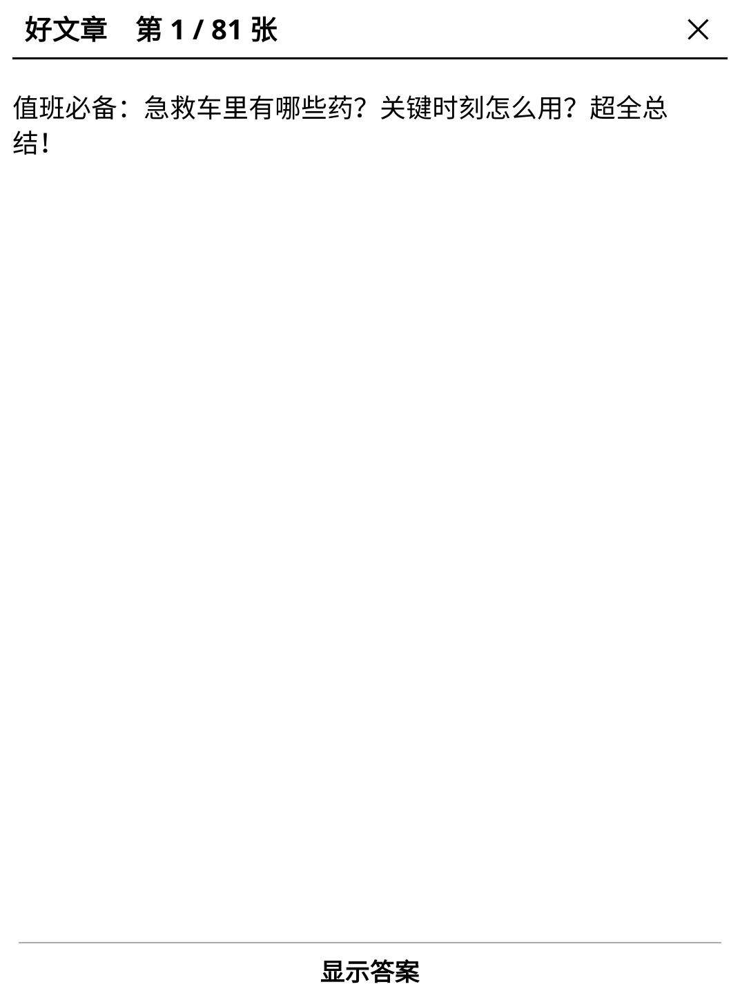
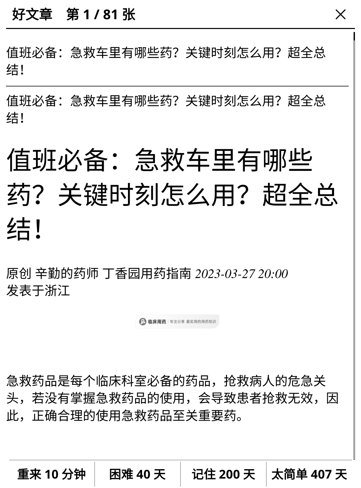
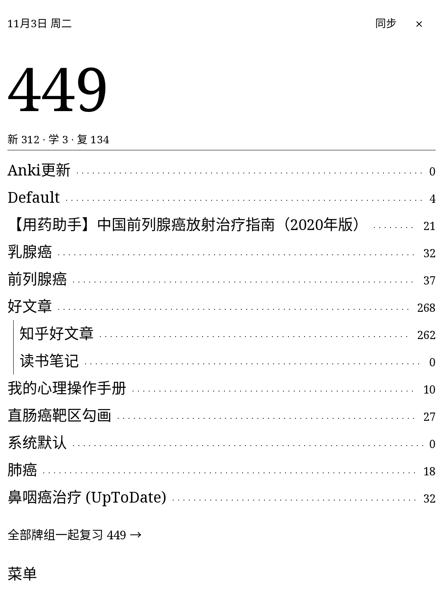

# Kindlearnki

**在 Kindle 上刷 Anki 卡片。** 电子墨水屏学习，进度同步云端，无缝衔接手机、电脑上的 Anki。

<p align="center">
  
  
  
</p>

> **English** — Study your Anki decks on a jailbroken Kindle. Flip cards on e-ink, grade them,
> and your progress syncs both ways with AnkiWeb — review on the Kindle, continue on your phone.
> Needs KOReader on a jailbroken Kindle. [Install](#安装).

---

## 这东西适合你吗

**适合**，如果你：

- 有一台**已越狱**的 Kindle，上面装了 KOReader；
- 平时在手机或电脑上用 Anki 背东西，想躺床上把当天的量刷完；
- 只需要「看卡 → 评分 → 明天该背哪些卡」这一件事，其余交给 Anki 自己的算法。

**不适合**，如果你：

- 想在 Kindle 上做卡、改卡、看统计、导入 `.apkg` —— 这些都没有，请在手机/电脑上弄好再同步过来；
- Kindle 没越狱，或者没装 KOReader；
- 卡片带音频、视频 —— 只支持图片，而且得手动拷一次；
- **希望插件自动把图片同步到 Kindle 上** —— 这个功能不会做，现在不会，以后也不会（[为什么](#云端媒体同步不做以后也不会做)）。

## 装之前

1. 一台**已越狱**的 Kindle；
2. 上面装着 **KOReader**（2026.07.1 或更新）。怎么判断：能正常打开一本书就行；
3. 一根数据线（或者会用 Kindle 上的 `kterm`）。

## 安装

**第 1 步 · 下载**

去 [Releases](https://github.com/DrSkyeagle/kindlearnki/releases/latest) 下 `kindlearnki-koplugin-0.3.5.zip`，或者 `.tgz`。两个内容一模一样，zip 是给电脑解压用的，tgz 是给 `kterm` 直接解压用的。

**第 2 步 · 放进插件目录**

用电脑（推荐，不用敲命令）：

1. Kindle 连电脑，打开 Kindle 那个盘；
2. 进到 `koreader/plugins/`；
3. 把 zip 解压出来的 `kindlearnki.koplugin` **整个文件夹**拷进去。

在 Kindle 上用 `kterm`：

```bash
cd /mnt/us/koreader/plugins
tar -xzf /mnt/us/kindlearnki-koplugin-0.3.5.tgz
```

放对了的样子：`koreader/plugins/kindlearnki.koplugin/main.lua` —— 也就是说，点进 `kindlearnki.koplugin` 这一层，能直接看到 `main.lua`。

如果点进去又是一个 `kindlearnki.koplugin` 文件夹（套了两层），插件不会加载。

**第 3 步 · 重启 KOReader**

完全退出再重新打开（不是锁屏）。

**确认装上了**：主菜单 → **工具**（扳手图标）→ 拉到最底 → 能看到 **Kindlearnki**。

## 第一次用

1. 工具 → Kindlearnki → **立即同步**；
2. 第一次会让你登录：填 AnkiWeb 的邮箱和密码，就是手机上 Anki 用的那个账号；
3. 登录成功后会自动把整个卡片库下载下来，大约几 MB，看网速；
4. 回菜单点 **开始复习** → 选牌组，或者「全部牌组一起复习」。

评分四个键：`重来` / `困难` / `记住` / `太简单`，和 Anki 一样。Voyage 要用侧边翻页键的话，得从 KUAL 里那个 **no-framework** 入口启动 KOReader（不加载 Kindle 系统框架），普通启动方式下侧键翻页不生效；`×` 退出。

刷完之后回菜单点一次 **立即同步**，进度推到云端，手机上打开 Anki 就能接着刷。

> 一次复习到一半退出也没事，进度存在本地，下次进来还是接着来。

## 卡片里的图片

插件**不会联网下载图片**（Kindle 网速慢，AnkiWeb 的媒体同步又重），图片需要你自己拷一次，之后就一直在了。

图片放在这个目录，第一次启动时自动建好，一直是空的：

```
在设备上：  /mnt/us/koreader/kindlearnki/media/
连电脑后：  Kindle/koreader/kindlearnki/media/
```

把电脑里 Anki 的 `collection.media` 文件夹里的**文件**平铺拷进去 —— 不改文件名、不建子文件夹。拷完拔线，重新进复习界面就能看到图。

- **找不到 `collection.media`**：Anki 菜单 → 工具 → 检查媒体 → 打开文件夹。Windows 上默认在 `%APPDATA%\Anki2\<你的用户名>\collection.media`。
- **卡上还是显示 `[image]`**：说明这张卡的图还没拷进去。`[image]` 是「图找不到」的占位符，不是「不支持图片」。
- **不想拷也行**：不会弹提醒，卡片照常能刷，只是没图。
- **想放别的目录**：在 `koreader/settings/kindlearnki.lua` 里加一行 `media_dir = "/mnt/us/你想放的路径"`。

## 云端媒体同步：不做，以后也不会做

AnkiWeb 自己支持同步媒体。**这个插件不会去同步，将来也不会加这个功能。**

这不是「还没做完」，是决定不做。原因就一条：**Kindle 在这套东西里的角色是「只读复习终端」，不是内容管理设备。**

- **做卡、改卡、导 `.apkg`、整理媒体，都在手机和电脑上完成。** Kindle 只负责一件事：你躺下的时候，把今天该背的卡刷完。让墨水屏去干内容管理的活，它干不好，你也不会想在它上面干。
- **媒体同步是整条链路里最重的一环。** 一个用了两三年的 Anki 库，媒体动辄几百 MB 到几个 GB。Kindle 的 WiFi 弱、休眠策略激进，传到一半断掉是常态；墨水屏刷新一次要几百毫秒，盯着进度条本身就很折磨。为了省下「插一次 USB」，换来几分钟到几十分钟的不确定等待——不值。
- **装不下。** 不少机型可用空间就几个 GB，媒体塞进去会挤掉书。
- **要写的代码和要担的风险，远超收益。** 媒体同步得处理分块上传、断点续传、失败重试、增量校验、冲突合并——这套东西的复杂度和出错面比「复习」本身还大，而它换来的只是「少插一次线」。

**USB 拷一次，之后长期有效。** 换设备、重刷系统才需要再拷一遍。音频、视频同理：不支持，也不打算支持。

如果确实想让 Kindle 联网拿媒体，办法是在电脑上把 `collection.media` 同步到 Kindle 挂载的 `koreader/kindlearnki/media/`（FreeFileSync、rsync、一个计划任务都行）。那是你的选择——插件不插手，也不会因此去实现媒体同步协议。

## 换账号，或者清掉本地库

菜单里有两个，点之前都会再问一次：

| 菜单项 | 会删什么 | 什么时候用 |
|---|---|---|
| **删除卡片库** | Kindle 上的卡片数据。**保留登录** | 觉得本地数据不对劲，想让下次同步从云端整个重新下一遍 |
| **注销本地账户** | 登录状态 **+ 卡片数据** | 要换 Anki 账号时用 |

换账号**必须**用「注销」：只退出登录不删库的话，新账号第一次同步会把旧账号的卡片和复习记录混进来。

## 同步会不会和手机打架

不会。同步是双向的：Kindle 上刷的推上去，手机上刷的拉下来。（同步协议的行为按 AnkiDroid 的实现校准，代码为本项目自写，未包含第三方源码。）

几个你可能会担心的情况：

- **手机上刚改过牌组或卡片类型** → Kindle 这边不会让你「整库重下」，会自己把两边合起来，你本地的复习也不会丢；
- **同步中途网断了** → 这次没推上去的复习不会被当成「已发送」，下次同步会补推；
- **两边同时刷了同一张卡** → 按修改时间取新的那份，和 Anki 自己的规则一致。

## 密码安全吗

密码不保存。登录成功后只存一把「钥匙」（AnkiWeb 叫 hkey），以后用它证明身份。

这把钥匙在 Kindle 上是明文的，等于一张长期有效的通行证 —— 借别人 Kindle 之前，先点菜单里的**注销本地账户**；忘了的话，也可以去 AnkiWeb 网页版 → 设置 → 已登录设备，把设备踢掉。

## 现在还做不到

- **不做浏览、编辑、统计、导入。** Kindle 只当复习机用，做卡请在手机/电脑上做。
- **图片要手动拷一次，音频、视频不支持。** 云端媒体同步是明确的「不做」项，不是待办——原因见上面[「云端媒体同步：不做」](#云端媒体同步不做以后也不会做)一节。
- **只在 Kindle Voyage 上实测过**，另外在 5.13.6 固件的模拟器里跑过完整流程。其它型号理论上能用（只要 KOReader 能跑起来），但我没有真机验证过。
- **只能用 AnkiWeb 官方同步**，不支持自建同步服务器。

## 数据放在哪

| 内容 | 位置 |
|---|---|
| 卡片库 | `koreader/kindlearnki/collection.anki2` |
| 登录凭证（hkey） | `koreader/settings/kindlearnki.lua` |
| 卡片图片 | `koreader/kindlearnki/media/` |

同步前会自动备份一份 `collection.anki2.bak`。

## 从 kindleanki 升级

0.3.0 起项目改名为 **kindlearnki**（原来叫 kindleanki，改名是为了不和另一个同名项目混淆）。

1. **先把旧的插件目录整个删掉**：`koreader/plugins/kindleanki.koplugin/`。
   不删会怎样：两个插件抢同一批模块，新插件启动报错、进不去。日志里会提示你删旧目录，看到类似 `migrate_legacy` 的报错就是这个原因。
2. 按上面的[安装](#安装)步骤放进 `kindlearnki.koplugin`。
3. 第一次启动会自动把旧的卡片库和登录状态复制到新位置，**进度和登录都保留**，旧文件原样留着，想回退随时可以。

小提示：本项目与 [`yizhixiaoheigou/kindle-anki`](https://github.com/yizhixiaoheigou/kindle-anki) 的插件不冲突（目录名不同、数据目录不同），这位作者的作品也很好，两个可以同时装着对比。

<details>
<summary><b>给想改代码的人（点开）</b></summary>

### 目录结构

```
kindlearnki.koplugin/   插件本体（Lua）
  core/                 版本、路径、能力探测、日志
  db/                   sqlite 连接与排序规则
  sched/                调度：队列、状态、评分、跨天
  render/               卡片模板求值 + CSS 消毒
  proto/                AnkiWeb 协议的 protobuf 与 zstd 编解码
  sync/                 同步流程
  study/                复习界面与控制器
  ui/                   牌组页、组件
  doc/                  使用说明、验收记录、SYNC-SPEC、SCHED-SPEC
harness/                真机/模拟器端到端脚本、mock AnkiWeb
tools/                  离线测试用 LuaJIT（Windows）、打包与部署脚本
```

### 跑测试

不需要 KOReader，仓库自带 Windows 用的 LuaJIT：

```bash
./tools/lj/luajit.exe kindlearnki.koplugin/tests/run.lua        # 248 例，0 失败
# 可选：接真实集合，覆盖真卡片真模板的集成用例
KINDLEARNKI_TEST_COLLECTION=/path/to/collection.anki2 \
  ./tools/lj/luajit.exe kindlearnki.koplugin/tests/run.lua
```

真机 / 固件模拟器级验证（会渲染截图，需要一份 KOReader 源码树）：

```bash
bash harness/run_sync_e2e.sh          # 对 mock AnkiWeb 跑完整同步（正常/结构变更/失败注入）
bash harness/emu/emu_up.sh            # 启动 Kindle 5.13.6 固件模拟器并装插件
bash harness/emu/emu_nav.sh decklist  # 驱动界面（httpinspector）
bash harness/emu/emu_sync_mock.sh     # 固件内跑完整同步
bash harness/media_shot.lua           # 图片渲染证据：有/无媒体目录各拍一次，两张不同才算生效
```

### 实现上的取巧与出处

- **调度**按 Anki v3 核心实现：三队列、每日限额、学习步与重学步、ease 与间隔、leech、兄弟卡 bury、凌晨 4 点跨天。逐条语义与出处见 `doc/SCHED-SPEC.md`。
- **同步**走 AnkiWeb 协议 v11 + schema 18：增量同步、整库双向、`sanityCheck2` 校验。逐条出处见 `doc/SYNC-SPEC.md`。
- **卡片渲染**走 KOReader 的 `ScrollHtmlWidget` + MuPDF，按 Anki 模板语义求值（条件、cloze），样式经消毒后才进渲染层。图片依赖 `html_resource_directory` 指向媒体目录 —— 这一项在 0.3.2 之前一直是 `nil`，所以图片一律显示成占位符。
- **版本号**单一来源是 `core/version.lua`，`_meta.lua`、`main.lua` 与 `protocol.lua` 都从它读，`tests/test_version.lua` 会在漂移时报错。

</details>

## 致谢

- [`yizhixiaoheigou/kindle-anki`](https://github.com/yizhixiaoheigou/kindle-anki)（v0.2.0）：复习页的**卡片渲染布局与视觉风格**参考了该项目。本项目为独立实现，未包含其源代码。
- [`ankitects/anki`](https://github.com/ankitects/anki) 的 `rslib` 与 [`ankidroid/Anki-Android`](https://github.com/ankidroid/Anki-Android)：调度语义与同步协议的事实依据。
- [KOReader](https://github.com/koreader/koreader)：插件运行时、HTML 渲染、LuaSocket/LuaSec 与 zstd。

非官方项目：与 Anki、AnkiWeb、Amazon Kindle 均无隶属关系。

## 许可

[AGPL-3.0-or-later](LICENSE)。第三方组件与借鉴说明见 [THIRD_PARTY_NOTICES.md](THIRD_PARTY_NOTICES.md)。
